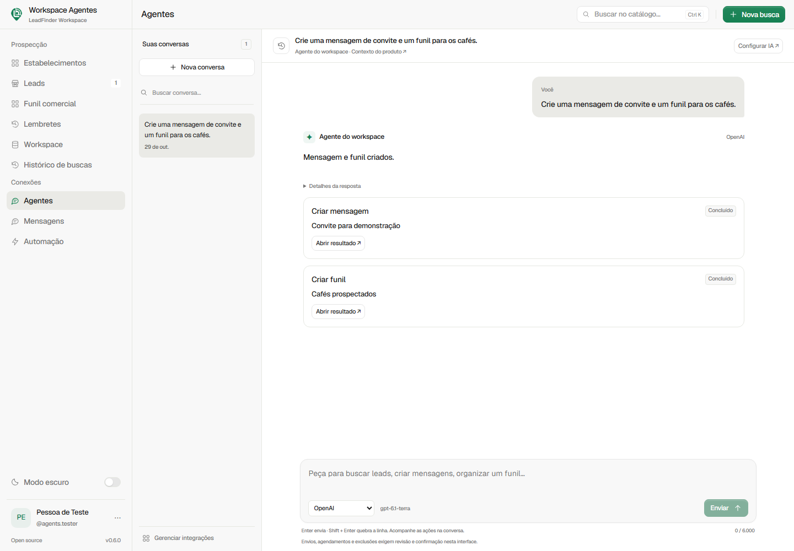
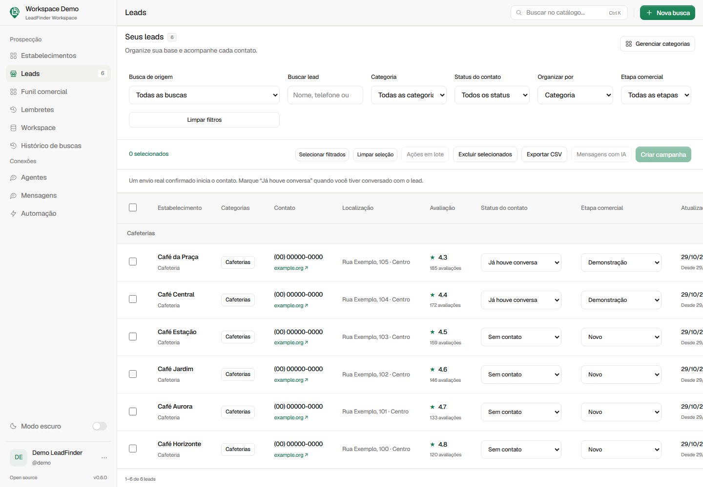

<p align="center">
  
</p>
<h1 align="center">LeadFinder</h1>
<p align="center"><strong>Descubra negócios. Organize oportunidades. Comece conversas.</strong></p>
<p align="center">Open source · Python + Flask · SQLite · Temas claro e escuro</p>
<p align="center">
  <a href="#começar">Começar</a> ·
  <a href="#o-que-você-pode-fazer">Recursos</a> ·
  <a href="docs/USER_GUIDE.md">Guia de uso</a> ·
  <a href="CONTRIBUTING.md">Contribuir</a> ·
  <a href="LICENSE">Licença MIT</a>
</p>

LeadFinder é um workspace local para encontrar estabelecimentos no Google Maps, catalogar informações públicas e acompanhar oportunidades comerciais. Da descoberta ao primeiro contato, reúne leads, mensagens, funis e um agente de IA que opera as ferramentas do próprio aplicativo.

**Versão atual: 0.6.0.** Os dados ficam em SQLite no seu computador. O frontend usa HTML, CSS e JavaScript, sem etapa de build ou CDN.

## O que você pode fazer

| Fluxo | Recursos |
|---|---|
| **Descoberta** | Busca por segmento e região, CEP com raio e filtro de telefone. Progresso, cancelamento e histórico com motivos dos descartes. |
| **Leads** | Categorias, filtros, paginação, seleção entre páginas, edição individual, ações em lote, exclusão revisada e exportação CSV. |
| **Relacionamento** | Ficha com notas, linha do tempo, status de conversa, etapas comerciais e lembretes. |
| **Funis** | Quadro Kanban e visões segmentadas por texto, categoria, contato e presença de telefone. |
| **Agentes** | Conversas com OpenAI, OpenRouter ou Claude para pesquisar e organizar leads, salvar mensagens, criar funis e preparar campanhas. |
| **Mensagens** | Biblioteca de modelos, variáveis de personalização e prévia com cliente fictício. |
| **Automação** | Simulação local, envio para número de teste, disparos revisados, intervalo entre mensagens, pausa, recuperação e agendamento. |
| **Workspace** | Conta e dados isolados, contexto do produto para a IA, temas claro/escuro e backup portátil cifrado por senha. |

**O agente registra o resultado de cada ação.** Envios reais, agendamentos, retomadas e exclusões precisam de revisão e confirmação pelos botões da interface. Uma resposta “sim” no chat não aprova essas ações.

### Por dentro do aplicativo

As telas abaixo usam apenas dados fictícios e provedores simulados.





## Começar

Requisitos: **Python 3.11 ou superior**. O Maps exige internet e o Chromium instalado pelo Playwright. WhatsApp e IA são integrações opcionais.

### Windows · PowerShell

```powershell
git clone https://github.com/esc4n0rx/LeadFinder.git
cd LeadFinder
python -m venv .venv
.\.venv\Scripts\python.exe -m pip install -e .
.\.venv\Scripts\python.exe -m playwright install chromium
.\.venv\Scripts\python.exe -m leadfinder
```

### macOS / Linux

```bash
git clone https://github.com/esc4n0rx/LeadFinder.git
cd LeadFinder
python3 -m venv .venv
.venv/bin/python -m pip install -e .
.venv/bin/python -m playwright install chromium
.venv/bin/python -m leadfinder
```

Abra **http://127.0.0.1:5000**, crie sua conta e dê um nome ao workspace. Para iniciar novamente, execute apenas o último comando.

> O servidor usa um processo e escuta em `127.0.0.1`. Não inicie duas instâncias apontando para o mesmo banco. A instalação padrão é para uso local.

### WhatsApp · opcional

Requer **Node.js 22.12 ou superior**. No PowerShell:

```powershell
$env:PUPPETEER_SKIP_DOWNLOAD = "true"
npm.cmd ci --prefix leadfinder/integrations/whatsapp
```

No macOS/Linux: `PUPPETEER_SKIP_DOWNLOAD=true npm ci --prefix leadfinder/integrations/whatsapp`.

Em **Perfil → Integrações → WhatsApp**, informe nome e número, salve e conecte pelo QR code. O bridge usa o Chromium do Playwright e mantém a sessão por workspace. Navegar entre telas ou sair do LeadFinder não desconecta o WhatsApp.

O conector utiliza **whatsapp-web.js / WhatsApp Web**, e não a API oficial WhatsApp Business. Sem integração ativa, você ainda pode usar a **simulação local**, que não envia mensagens.

### Inteligência artificial · opcional

Em **Perfil → Integrações → Inteligência artificial**, conecte sua chave da OpenAI, OpenRouter ou Anthropic/Claude, escolha um modelo que suporte ferramentas e teste a conexão. As chamadas usam a API e o saldo do provedor; uma assinatura de aplicativo de chat não substitui essa chave.

Em **Workspace**, descreva produto, diferenciais, público, oferta e tom de voz. Depois, abra **Agentes**:

> Crie e salve duas mensagens para apresentar meu produto a hamburguerias: um primeiro contato curto e um follow-up com um CTA simples.

> Crie um funil para os leads da categoria Hamburguerias e prepare um disparo com essas mensagens, sem iniciar o envio.

O agente consulta os dados atuais e usa ferramentas delimitadas ao seu workspace. Não possui ferramentas genéricas de terminal, arquivos, SQL ou acesso a credenciais.

## Primeiro fluxo

1. Em **Estabelecimentos**, crie uma categoria e pesquise um segmento, como cafeterias, em uma região ou ao redor de um CEP.
2. Acompanhe a coleta. Ao concluir com resultados, a tabela abre em **Leads**, filtrada pela busca.
3. Organize categorias e etapas, corrija dados, registre uma conversa ou crie um lembrete na ficha do lead.
4. Crie modelos em **Mensagens** ou peça ao **Agente** para criá-los com base no contexto do seu produto.
5. Em **Automação**, prepare e revise os destinatários e textos. Comece com **Simulação local · sem envio**.
6. Para conferir o recebimento de verdade, use **WhatsApp · número de teste** com um destinatário autorizado e integração conectada.

Os funis usam as etapas **Novo → Contatado → Respondeu → Demonstração → Cliente**, além de **Perdido**. Um envio aceito inicia o contato; o status “Já houve conversa” é confirmado manualmente.

## Dados, privacidade e limites

- **Campos públicos:** nome, telefone comercial, endereço, categoria, site, nota, avaliações, horários, Plus Code, coordenadas e outros detalhes disponibilizados pelo Maps. Campos ausentes ficam vazios; não há enriquecimento em sites externos.
- **Coleta por raio:** o ponto do CEP e o dos estabelecimentos são confirmados na localização carregada pelo Maps. A distância é em linha reta. A coleta informa separadamente telefone não encontrado, fora do raio e coordenadas ausentes.
- **Fontes externas:** o Maps pode mudar o DOM, limitar resultados ou exigir uma verificação. O coletor interrompe diante de CAPTCHA; não usa evasão, proxies ou bypass. Os resultados não equivalem a uma varredura completa da região.
- **Envios:** a confirmação do servidor do WhatsApp não comprova entrega ou leitura. Não há inbox nem leitura automática de respostas. Tentativas sem confirmação pausam a execução e exigem conferência antes de retomar.
- **Dados locais:** banco, sessões e chaves ficam em `instance/`, excluída do Git. Chaves de IA são cifradas e nunca retornam completas ao navegador. Dados consultados pelo agente podem ser enviados ao provedor de IA escolhido.
- **Backup:** em **Workspace**, exporte um arquivo cifrado por senha. A restauração remapeia os registros e não inicia disparos ou aprova ações pendentes automaticamente. Guarde a senha para conseguir restaurar.

Use os contatos de forma responsável, com destinatários que esperam a comunicação, e observe as condições aplicáveis dos serviços integrados.

## Configuração

As variáveis de [`.env.example`](.env.example) devem ser definidas no terminal; o arquivo não é carregado automaticamente.

| Variável | Padrão | Finalidade |
|---|---|---|
| `LEADFINDER_DATABASE` | `instance/leadfinder.sqlite3` | Caminho da base |
| `LEADFINDER_PORT` | `5000` | Porta do servidor local |
| `LEADFINDER_HEADLESS` | `true` | `false` mostra o navegador da coleta |
| `LEADFINDER_BROWSER_CHANNEL` | vazio | Usar `chrome` ou `msedge` instalado |
| `LEADFINDER_SECURE_COOKIES` | `false` | Ativar cookies seguros em uma implantação HTTPS |
| `LEADFINDER_NODE_BINARY` | `node` no PATH | Executável Node.js da integração |
| `LEADFINDER_WHATSAPP_BROWSER` | Chromium do Playwright | Executável alternativo do navegador do WhatsApp |

## Desenvolvimento e testes

```powershell
.\.venv\Scripts\python.exe -m unittest discover -s tests -v
node tests/whatsapp_identity.cjs
node tests/whatsapp_bridge.cjs
```

Com Chromium instalado, confira os fluxos em bases temporárias:

```powershell
.\.venv\Scripts\python.exe -m tests.browser_smoke
.\.venv\Scripts\python.exe -m tests.browser_agents
.\.venv\Scripts\python.exe -m tests.browser_maps_fields
```

Esses testes usam dados fictícios e provedores simulados, sem gerações pagas ou mensagens externas. Os testes `tests.live_*` são opcionais e acessam serviços reais. Veja os comandos e a cobertura no [guia de uso](docs/USER_GUIDE.md).

### Organização do código

```text
leadfinder/
  __init__.py          # Factory e composição dos serviços
  repository.py        # SQLite, consultas e persistência
  migrations.py        # Migrações transacionais com backup
  services.py          # Coleta e execução em background
  accounts.py, auth.py # Contas, sessões e workspaces
  crm.py, funnels.py   # Relacionamento, etapas, notas e segmentos
  lead_editor.py       # Edição e exclusão revisada de leads
  outreach.py          # Mensagens e snapshots de disparos
  campaigns.py         # Execução, pausa, recuperação e agenda
  backups.py           # Exportação cifrada e restauração
  ai/                  # Provedores, credenciais, conversas e ferramentas
  collectors/          # Maps, geocodificação e parsing
  integrations/        # Bridge de WhatsApp
  templates/, static/ # Interface Jinja, CSS, JavaScript e assets
tests/                # Contratos, domínio, API e fluxos de navegador
```

## Documentação

- [Guia de uso](docs/USER_GUIDE.md)
- [Agentes, ferramentas e confirmações](docs/AGENTS_GUIDE.md)
- [Integrações de IA](docs/AI_INTEGRATIONS.md)
- [CRM, campanhas, recuperação e backups](docs/GROWTH_PHASE.md)
- [Design system](docs/DESIGN_SYSTEM.md) e [componentes de interface](docs/BEAUTIFUL_UI.md)
- [Marca e logo](docs/BRANDING.md)
- [Créditos e licenças de terceiros](THIRD_PARTY_NOTICES.md)

## Contribuir

Veja [CONTRIBUTING.md](CONTRIBUTING.md). São bem-vindas melhorias de coleta, acessibilidade, testes e experiência de uso. Não inclua bancos de leads, credenciais, sessões de navegador ou dados pessoais em commits e issues.

## Licença

[MIT](LICENSE). As dependências, fontes e referências visuais mantêm suas respectivas licenças, descritas em [THIRD_PARTY_NOTICES.md](THIRD_PARTY_NOTICES.md).
